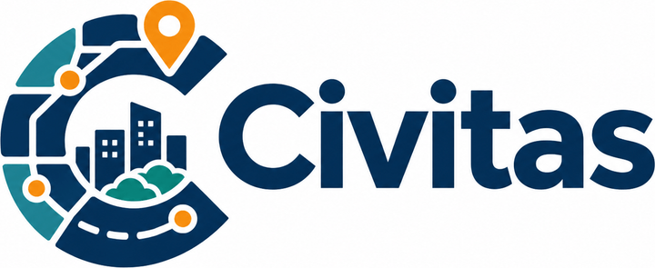
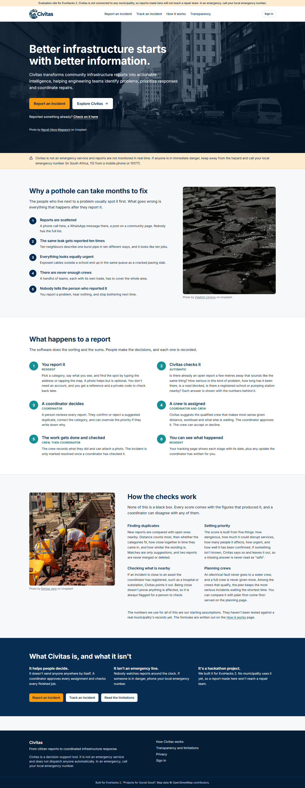
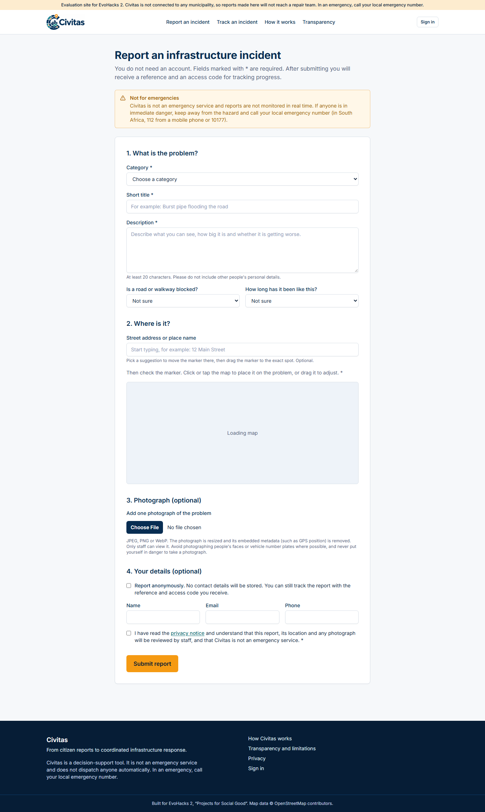
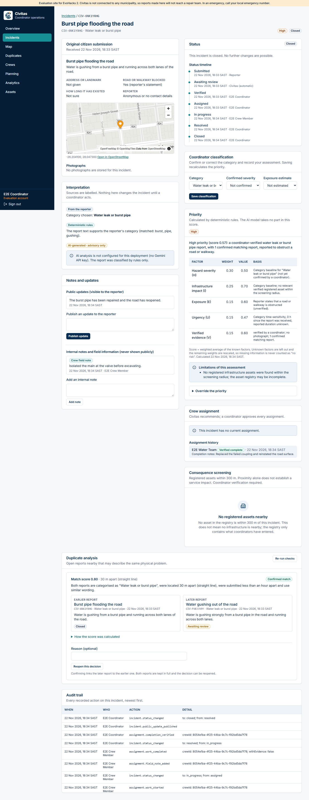
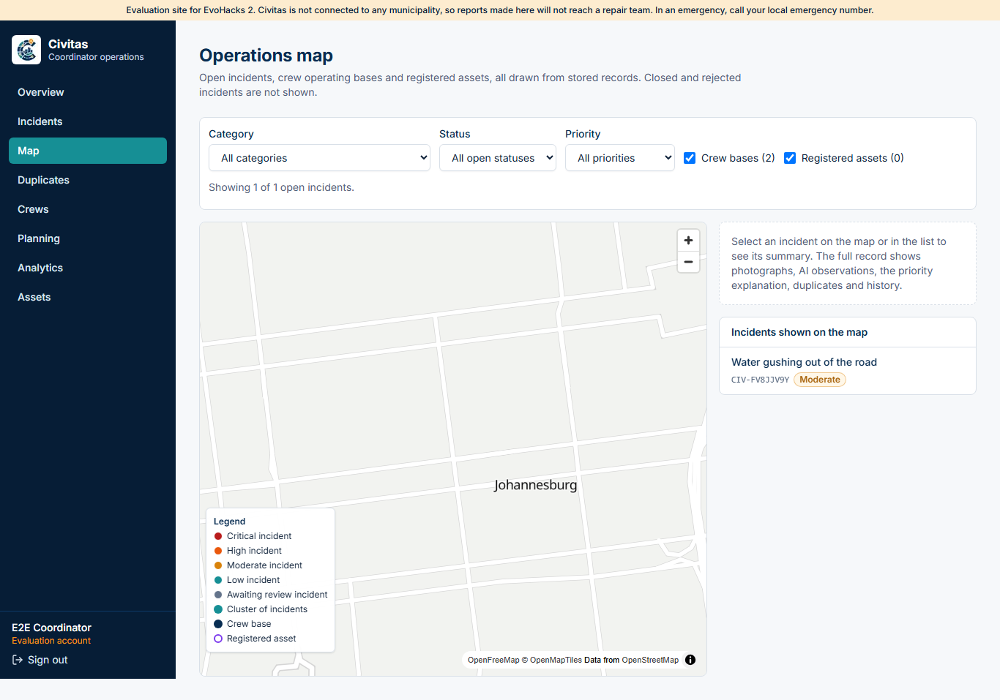
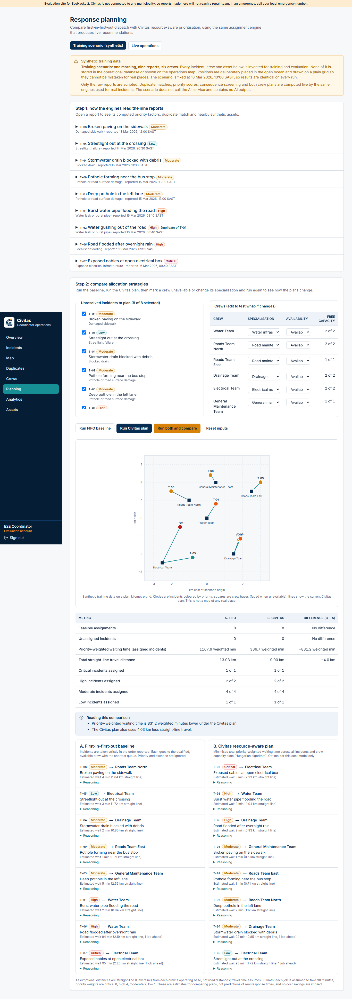
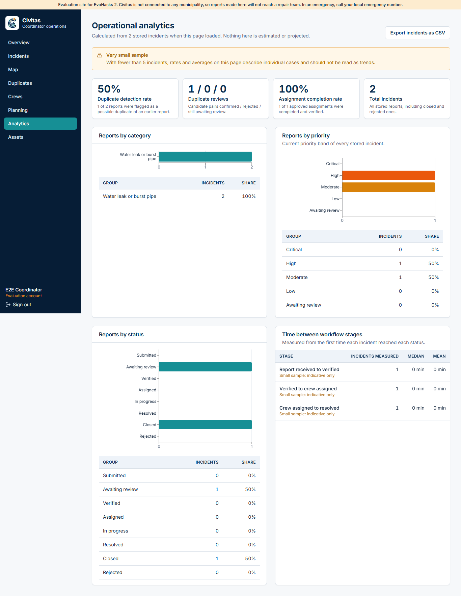

<p align="center">
  
</p>

# Civitas

**From citizen reports to coordinated infrastructure response.**

Civitas is a geospatial infrastructure incident intelligence platform. Citizens report problems such as burst pipes, potholes and exposed cables; Civitas checks each report for duplicates, scores its priority with an explainable rule engine, screens it against registered critical assets, and recommends a qualified maintenance crew. A municipal coordinator makes every decision, and the citizen can follow progress without creating an account.

Built for **EvoHacks 2** (theme: *Projects for Social Good*).

> Civitas is a decision-support tool. It is **not** an emergency service, it does not dispatch anyone automatically, and it is not deployed with or used by any municipality. Every weight, radius and threshold in it is an initial engineering assumption, not a validated municipal standard.

## Contents

1. [The social problem](#the-social-problem)
2. [Core functionality](#core-functionality)
3. [Screenshots](#screenshots)
4. [Architecture](#architecture)
5. [Technology stack](#technology-stack)
6. [Installation](#installation)
7. [Environment configuration](#environment-configuration)
8. [Database setup](#database-setup)
9. [Local development](#local-development)
10. [Running tests](#running-tests)
11. [Netlify deployment](#netlify-deployment)
12. [Security considerations](#security-considerations)
13. [Geospatial duplicate detection](#geospatial-duplicate-detection)
14. [Prioritisation algorithm](#prioritisation-algorithm)
15. [Consequence screening](#consequence-screening)
16. [Assignment algorithm](#assignment-algorithm)
17. [Demonstration instructions](#demonstration-instructions)
18. [AI-use disclosure](#ai-use-disclosure)
19. [Limitations](#limitations)
20. [Third-party attribution](#third-party-attribution)

## The social problem

Infrastructure failures are usually noticed first by the people who live beside them. Turning those observations into repairs is hard for five connected reasons:

1. Complaints arrive through fragmented channels and are not a shared record.
2. Many reports are incomplete, duplicated or geographically ambiguous.
3. Coordinators struggle to tell urgent hazards from routine maintenance.
4. A small number of repair crews must be allocated across competing incidents.
5. Citizens rarely hear what happened to their report.

Civitas addresses these with one structured intake, deterministic checks that explain themselves, a resource-aware crew plan, and a tracking page for the reporter.

## Core functionality

**Citizens (no account)**

- Report an incident: category, title, description, location (address suggestions as you type, then click or drag the map marker; device location with permission; or typed coordinates), optional photograph and optional contact details. Anonymous reporting is supported.
- Receive a random reference (`CIV-XXXXXXXX`) and a 20-character access code. Only a SHA-256 hash of the code is stored.
- Track status, a timeline and public updates, and add further information.

**Coordinators**

- Overview of counts computed from stored records; searchable, filterable, paginated incident table; CSV export.
- Incident record showing the original submission, a labelled interpretation panel (reporter / deterministic rules / AI), priority factors and limitations, consequence screening, duplicate candidates, crew recommendations, status timeline and audit trail.
- Confirm or reject possible duplicates. Nothing is merged or deleted, and a decision can be reopened.
- Correct the classification, record severity and exposure, override priority with a written reason (audited).
- Assign, reassign and cancel crews; approve planner proposals; verify or return completed work; publish citizen-visible updates.
- Manage crews and the infrastructure asset registry; view an operations map and analytics.
- Compare first-in-first-out dispatch with the Civitas plan in the planning simulator.

**Maintenance crew members**

- See only their own crew's assignments, without reporter contact details or internal notes.
- Accept or decline (with a reason), start work, add field notes, request assistance, and mark work complete with notes and an optional photograph for coordinator verification.

## Screenshots

These were captured from the running application by the end-to-end test run (`CIVITAS_CAPTURE=1 npm run test:e2e`), using records created during that run. The planning screenshot shows the synthetic training scenario.

| | |
|---|---|
|  |  |
| Home | Report an incident |
|  |  |
| Incident record | Operations map |
|  |  |
| Planning simulator (synthetic scenario) | Analytics |

## Architecture

One TypeScript application; there is no second backend service.

```
Browser
  ├─ Public pages, report form, tracking page          (React, MapLibre GL JS)
  └─ Coordinator dashboard, crew workspace             (React Server Components + server actions)
        │
Next.js on Netlify (App Router)
  ├─ Route handlers   /api/incidents  /api/track  /api/images/[id]  /api/export/incidents  /api/auth
  ├─ Server actions   src/lib/actions      (resolve the signed-in actor, validate, call a service)
  ├─ Services         src/lib/services     (authorisation, transactions, audit trail)
  ├─ Engines          src/lib/engines      (pure functions: duplicates, priority, screening, assignment)
  ├─ AI               src/lib/ai           (Gemini REST client, Zod schema, rule-based classifier)
  └─ Storage          src/lib/storage      (image validation and re-encoding, private object store)
        │
  PostgreSQL (Netlify DB)      Netlify Blobs (photographs)      Gemini API (optional, advisory)
```

Key decisions and trade-offs:

- **Engines are pure functions** with no database or network access. The planning simulator runs the same `buildPlan` function in the browser that the server uses for live recommendations, so the demonstration cannot diverge from the product.
- **Authorisation lives in the service layer.** Every service function that reads or changes protected data takes an `Actor` and checks it, so a page or route cannot forget to.
- **A report is committed before anything optional runs.** Photograph storage, duplicate search, priority and AI analysis can each fail without losing the report.
- **AI is advisory and isolated.** The language model never sets priority, never changes a record and never dispatches anyone. Its output is accepted only if it passes a strict schema.
- **Embedded PostgreSQL for development and tests.** Without a database URL, local development uses [PGlite](https://pglite.dev) (PostgreSQL compiled to WebAssembly) with the same migrations. It is refused in production because serverless hosts do not persist the local filesystem.
- **Staff accounts are created by a script, not a public sign-up page**, to keep the administrative surface small.

Data model (18 tables, `src/lib/db/schema.ts`): `organizations`, `users`, `incidents`, `reporter_contacts`, `incident_images`, `ai_analyses`, `incident_observations`, `duplicate_candidates`, `duplicate_reviews`, `infrastructure_assets`, `priority_assessments`, `maintenance_crews`, `crew_members`, `crew_assignments`, `incident_status_history`, `public_updates`, `audit_events`, `rate_limits`. The training scenario is kept in code (`src/lib/scenario`) rather than a table, so it can never mix with operational rows.

## Technology stack

| Area | Choice |
|---|---|
| Framework | Next.js 16 (App Router), React 19, TypeScript (strict) |
| Styling | Tailwind CSS 4, Lucide icons |
| Maps | MapLibre GL JS 6 with OpenFreeMap tiles (OpenStreetMap data) |
| Charts | Recharts |
| Database | PostgreSQL (Netlify DB) through Drizzle ORM with SQL migrations; PGlite for local development and tests |
| Validation | Zod |
| Authentication | Auth.js (next-auth v5) credentials provider, bcrypt password hashes, JWT sessions |
| File storage | Netlify Blobs; images processed with sharp |
| AI | Google Gemini API (REST, JSON-schema output) |
| Tests | Vitest (unit, integration), Playwright (end-to-end) |

## Installation

Requirements: Node.js 20.9 or newer and npm.

```bash
git clone https://github.com/MaatlaHealth/Civitas.git
cd Civitas
npm install
```

## Environment configuration

Copy `.env.example` to `.env.local` and fill in what you need. Never commit real values.

| Variable | Required | Purpose |
|---|---|---|
| `AUTH_SECRET` | Yes | Signs staff sessions. Generate with `npx auth secret` or any 32+ byte random string. |
| `DATABASE_URL` | Production | PostgreSQL connection string. On Netlify, `NETLIFY_DATABASE_URL` is used automatically if this is unset. |
| `GEMINI_API_KEY` | No | Enables AI analysis. Without it reports are classified by rules only and the interface says so. |
| `GEMINI_MODEL` | No | Model name; defaults to `gemini-2.5-flash`. |
| `NEXT_PUBLIC_DEPLOYMENT_MODE` | No | Set to `evaluation` to show a banner stating the deployment is not connected to a municipality. |
| `NEXT_PUBLIC_MAP_STYLE_URL`, `NEXT_PUBLIC_MAP_CENTER_LAT`, `NEXT_PUBLIC_MAP_CENTER_LNG`, `NEXT_PUBLIC_MAP_ZOOM` | No | Basemap style and initial view (defaults: OpenFreeMap Positron, Johannesburg). |
| `CIVITAS_ORGANIZATION_NAME` | No | Name given to the organisation record created on first use. |
| `CIVITAS_OPEN_ACCESS` | No | Set to `true` to replace password sign-in with name-only sign-in for judges. **Anyone can then open the staff workspaces and read everything submitted, including contact details and photographs.** Never enable it on a deployment holding real reports. |
| `CIVITAS_ALLOW_EMBEDDED_DB` | No | Only for running `next start` locally without PostgreSQL. Never set on a serverless host. |

Only variables prefixed `NEXT_PUBLIC_` reach the browser; none of them is secret.

## Database setup

Migrations are plain SQL files in `drizzle/`, generated from the schema.

```bash
npm run db:migrate     # applies pending migrations to DATABASE_URL, or to the embedded dev database
npm run db:generate    # after changing src/lib/db/schema.ts: writes a new migration file
```

Create staff accounts (passwords are stored only as bcrypt hashes):

```bash
npm run users:create -- --email jane@example.org --name "Jane Dlamini" --role coordinator
npm run users:create -- --email sam@example.org --name "Sam Nkosi" --role crew --crew "Water Team"
```

Set `CIVITAS_NEW_USER_PASSWORD` (12+ characters) to choose the password; otherwise a random one is generated and printed once. Add `--evaluation` to label the account as an evaluation account in the interface. A crew must exist (create it on the dashboard's Crews page) before a crew member can be added to it.

Retention: `npm run retention:purge -- --days 90` erases reporter contact details for incidents closed or rejected longer ago than the given number of days (`--dry-run` to preview). Coordinators can also erase contact details and delete photographs per incident.

## Local development

```bash
cp .env.example .env.local        # set AUTH_SECRET at minimum
npm run db:migrate
npm run users:create -- --email you@example.org --name "Your Name" --role coordinator
npm run dev
```

Open http://localhost:3000. With no `DATABASE_URL`, data is stored in `./.data` (ignored by git). Stop the dev server before running scripts against the embedded database, because it can only be opened by one process at a time.

## Running tests

```bash
npm run typecheck          # TypeScript, strict
npm run lint               # ESLint
npm run test:unit          # engines, validation, permissions
npm run test:integration   # real services against in-memory PostgreSQL
npm run build && npm run test:e2e   # Playwright against the production build
```

Results recorded on 22 November 2026 (Windows 11, Node 24):

| Check | Result |
|---|---|
| Type check | Passed, 0 errors |
| ESLint | Passed, 0 errors, 0 warnings |
| Production build | Passed, 25 routes |
| Unit tests | 401 passed (14 files) |
| Integration tests | 26 passed (2 files) |
| End-to-end tests | 17 passed (Chromium), plus 1 passed for name-only sign-in (`CIVITAS_E2E_OPEN_ACCESS=1 npx playwright test`) |
| `npm audit` | 4 moderate findings, all in `drizzle-kit` (a development-only migration generator, via an old bundled esbuild). No findings in runtime dependencies. |

What the tests do and do not show:

- **Integration tests** run the real service layer and real SQL migrations against PGlite. Object storage is replaced by an in-memory store and the Gemini HTTP API by a stubbed `fetch`. They are **mocked** integration tests of the AI path: they prove request shaping, schema validation, retry and failure handling, not that the live Gemini service responds.
- **End-to-end tests** drive a real browser through the whole journey (report, track, duplicate confirmation, priority, assignment, crew work, closure, citizen view), the planning simulator, role enforcement, map loading, address suggestions and a 360 px overflow check on every page. They run with no Gemini key, so they exercise the "AI not configured" path. The map and address tests need network access to the public tile and address search services.
- **Not yet executed:** a live Gemini call, and any test against a deployed Netlify site with Netlify DB and Netlify Blobs. See [Limitations](#limitations).
- Accessibility was checked through semantic queries in the end-to-end tests (roles, labels) and manual review only. No automated audit or assistive-technology testing has been done and no WCAG conformance is claimed.

## Netlify deployment

The repository is ready for Netlify's built-in Next.js support (no static export; server rendering, route handlers and server actions run as Netlify Functions).

1. **Create the site.** In Netlify choose *Add new site → Import an existing project* and select this repository. `netlify.toml` already sets the build command (`npm run build:netlify`), publish directory and Node version.
2. **Provision the database.** Add **Netlify DB** to the site (Extensions → Neon / Netlify DB, or `npx netlify db init`). This sets `NETLIFY_DATABASE_URL`, which Civitas uses automatically. Any PostgreSQL works if you set `DATABASE_URL` instead.
3. **Set environment variables** (Site configuration → Environment variables): `AUTH_SECRET` (required), `GEMINI_API_KEY` (optional), `NEXT_PUBLIC_DEPLOYMENT_MODE=evaluation` (recommended for the hackathon), and `CIVITAS_OPEN_ACCESS=true` only if you want judges to sign in with just a name (see the warning in the environment table). Redeploy after changing variables. Do not put secrets in `netlify.toml`.
4. **Deploy.** The build runs `scripts/migrate.ts` first, which applies migrations to the configured database, then builds. If no database URL is present the migration step is skipped with a warning in the build log, and the site will report that the database is unavailable.
5. **Create staff accounts** from your own machine against the production database:
   ```bash
   DATABASE_URL="<connection string from Netlify>" CIVITAS_NEW_USER_PASSWORD="<choose one>" \
     npm run users:create -- --email coordinator@example.org --name "Evaluation Coordinator" --role coordinator --evaluation
   ```
   Then sign in, create a crew on the Crews page, and create a crew member with `--role crew --crew "<crew name>"`.
6. **File storage** needs no setup: photographs go to a Netlify Blobs store named `incident-images`, which exists automatically for deployed sites.

Troubleshooting:

| Symptom | Likely cause |
|---|---|
| "This page could not be loaded" on dashboard pages | No database URL, or migrations were skipped. Check the build log for the migration warning. |
| Sign-in always fails | `AUTH_SECRET` missing, or the account was created in a different database. |
| Photograph upload reports it could not be stored | Netlify Blobs unavailable in this context; the report itself is still saved. |
| Maps show "could not be loaded" | The tile service is unreachable or blocked; typed coordinates and lists still work. |
| AI panel says "not configured" | `GEMINI_API_KEY` is not set. This is a supported state. |

Deployment has not been performed or tested from this repository yet; see [Limitations](#limitations).

## Security considerations

- **Validation and sanitisation:** all input is validated on the server with Zod; control characters are stripped; React escapes output.
- **Authentication:** Auth.js with bcrypt hashes; eight-hour sessions; role, active status and crew membership are re-read from the database on every request, so revoking access takes effect immediately.
- **Authorisation:** enforced in the service layer for every operation. Crew members can only see and act on their own crew's assignments.
- **Citizen tracking:** random non-sequential references; access codes stored only as hashes and compared in constant time; unknown reference and wrong code return the same error.
- **Uploads:** size limit, file-signature check, full re-encode to JPEG (drops EXIF, including GPS), private storage, served only through an authenticated route.
- **Open evaluation access:** when `CIVITAS_OPEN_ACCESS=true`, sign-in needs only a name and creates a labelled evaluation account. This deliberately removes the protection on staff data for a judging deployment; the site banner, sign-in page and report form say so. It is off by default.
- **Rate limiting:** database-backed fixed windows on report submission, tracking, address suggestions and sign-in; client addresses are hashed before storage.
- **Cross-origin:** no CORS headers are emitted; state-changing API routes reject mismatched origins; server actions use Next.js's built-in origin check.
- **Concurrency:** incidents carry a version number and updates are refused if the record changed underneath the user; assignment changes are conditional on the current state; one live assignment per incident is enforced by a partial unique index.
- **Errors and logs:** internal details are logged as structured JSON and never returned to users; report text, contact details and images are never logged.
- **Secrets:** read from environment variables only; `.env*` files are ignored by git.
- **Privacy:** contact details are optional, stored in a separate table, and can be erased independently of the incident. The design considers South African POPIA principles (minimal collection, purpose limitation, deletion), but **no legal compliance is claimed** and no assessment has been carried out. No security certification or independent review is claimed either.

## Geospatial duplicate detection

Code: `src/lib/engines/duplicates.ts`, `src/lib/geo/haversine.ts`, `src/lib/engines/text-similarity.ts`.

1. **Candidate generation.** A latitude/longitude bounding box around the new report is used as an index-friendly SQL prefilter over open incidents. Exact great-circle distance is then computed with the Haversine formula.
2. **Hard exclusions.** A pair is never a candidate if its categories are incompatible, or if it is further apart than the larger of the two categories' search radii (for example pothole 35 m, water leak 75 m, streetlight 25 m, flooding 150 m).
3. **Score.** `S = 0.40·G + 0.25·C + 0.20·T + 0.15·D`, every component in [0, 1]:
   - `G` geographic proximity: 1 at the same point, falling linearly to 0 at the search radius.
   - `C` category compatibility: 1 for the same category, a configured value for related ones (leak/flooding 0.6, blocked drain/flooding 0.7, and so on).
   - `T` temporal proximity: halves for every 72 hours between submissions.
   - `D` description similarity: Jaccard index of the two reports' vocabularies after lower-casing, removing stop words and stripping common suffixes. It measures shared words, not meaning, which is why it has the lowest weight.
4. **Threshold.** Pairs with `S ≥ 0.55` are stored for coordinator review, with the computed distance, each component and a plain-language explanation.

Civitas never merges reports. Confirming a pair links the later report to the earlier one and counts as corroboration for it; both records are kept in full, and reopening the decision removes the link.

## Prioritisation algorithm

Code: `src/lib/engines/priority.ts`. The language model takes no part in it.

`P = 0.30·H + 0.25·I + 0.15·E + 0.15·U + 0.15·V`

| Factor | Source |
|---|---|
| `H` hazard severity | Coordinator-confirmed severity if recorded, otherwise the category baseline. Unknown for "other" until confirmed. |
| `I` infrastructure impact | Category baseline, raised (by at most 0.30) for proximity to a **verified** registered asset that a screening rule makes relevant. |
| `E` exposure | Coordinator estimate if recorded, otherwise the reporter's answer about a blocked road or walkway. Unknown if neither exists; Civitas holds no population or traffic data. |
| `U` urgency | Category time-sensitivity, hours since the report, and the reporter's stated duration. |
| `V` verified evidence | Coordinator verification, a photograph, and up to three confirmed matching reports. |

Unknown factors are **excluded and the remaining weights rescaled**, so missing information is never treated as zero risk; each one is listed as a limitation. If `H` itself is unknown no score is produced and the incident is "Awaiting review". Bands: critical ≥ 0.75, high ≥ 0.55, moderate ≥ 0.35, otherwise low. The number of reporters is deliberately a small part of one factor, not a measure of severity. Coordinators can override the band with a written reason; the previous and new values are recorded and the incident is marked as manually adjusted.

## Consequence screening

Code: `src/lib/engines/screening.ts`. For each incident Civitas lists assets from the coordinator-maintained registry within 300 m (straight line), with the distance, the registry entry's verification status and source, and, where a rule exists, why that category of incident may matter to that type of asset. Every finding carries the statement "Proximity alone does not establish a service impact. Coordinator verification required." There is no network or structural simulation, and Civitas never creates asset records by itself.

## Assignment algorithm

Code: `src/lib/engines/assignment.ts`, `src/lib/engines/hungarian.ts`.

Eligibility is a hard filter: a crew must have a qualifying specialisation for the category (an electrical incident can never go to a water crew), be available, and have free capacity. The server enforces this when an assignment is created, not just in the interface.

Cost model: each crew offers one slot per unit of free capacity. For incident *i* in slot *s*:

```
wait(i, s) = travelMinutes(crew base → incident) + queuePosition(s) × serviceMinutes
cost(i, s) = priorityWeight(i) × wait(i, s)
```

with priority weights critical 8, high 4, moderate 2, low 1, travel at an assumed 30 km/h over straight-line distance, and an assumed 90 minutes per job.

- **Civitas plan:** minimises the total cost with the Hungarian algorithm over an incidents × slots matrix, with one "leave unassigned" column per incident so a feasible solution always exists. The unit tests check it against brute-force search on small cases.
- **FIFO baseline:** incidents strictly in reporting order, each to the qualified available crew with the shortest queue; priority and distance ignored.

The Civitas plan is optimal **for this cost model only**. It is not a vehicle-routing solution: distances are straight-line from the crew base, jobs are not chained into routes, and every job is assumed to take the same time. Recommendations and proposals always need coordinator approval.

## Demonstration instructions

A judge can experience the whole workflow on a deployment with one coordinator account and one crew member account.

**A. Planning comparison (synthetic training scenario, no setup needed)**

1. Sign in as a coordinator and open **Planning**. The "Training scenario (synthetic)" tab is selected.
2. Step 1 shows nine scripted reports. Open any of them to see the priority factors, duplicate match and nearby synthetic assets that the live engines computed. Report T-02 is matched to T-01 by the duplicate engine.
3. Choose **Run FIFO baseline**, then **Run Civitas plan**. On the unmodified scenario the recorded result is: both plans assign all 8 incidents; priority-weighted waiting 1167.9 (FIFO) versus 336.7 (Civitas) weighted minutes; straight-line travel 13.03 km versus 9.00 km.
4. Set a crew (for example the Electrical Team) to **Unavailable**, or change a crew's specialisation, and choose **Run both and compare**. The plans, unassigned list and metrics are recomputed.

The scenario's data is in `src/lib/scenario/training-scenario.ts`. Every record is invented, its coordinates are deliberately in the open South Atlantic, and it is drawn on a plain grid. It is never written to the database or shown on the operations map. It does not call the AI service and contains no AI output. The numbers above are estimates under the stated assumptions on synthetic inputs; they are not evidence of real-world response-time or cost improvements.

**B. Live workflow (real persisted records)**

1. As a citizen, open **Report an incident** and submit a water leak with a location. Save the reference and access code, then open **Track an incident**.
2. Submit a second, similar report a few tens of metres away.
3. As the coordinator, open the first incident: review the interpretation panel, the priority explanation and the duplicate candidate; confirm the match; verify the report; assign the recommended crew. (Create a water-infrastructure crew on the Crews page first.)
4. As the crew member, accept the job, start work, add a field note and mark it complete.
5. As the coordinator, verify the completion, publish a public update and close the incident.
6. As the citizen, track the report again: it shows the full timeline and the public update, and none of the internal notes.

To see consequence screening on a live incident, register an asset near the incident on the **Assets** page (with its source) and use **Re-run checks**.

## AI-use disclosure

AI was used in two distinct ways.

**In the product.** Google Gemini provides an optional, advisory description of a report's text and photograph. It is called only from the server, its output must pass a strict schema, it is labelled "AI-generated · advisory only" wherever shown, and it has no effect on priority, status or assignment.

**In development.** This codebase was produced with substantial AI assistance (Anthropic's Claude, via Claude Code) working from a detailed product specification written by the developer. See [`docs/AI_ASSISTANCE.md`](docs/AI_ASSISTANCE.md) for an account of what the AI produced and what the developer contributed. Authorship has not been altered: AI-assisted commits carry a `Co-Authored-By` trailer.

## Limitations

- **Not yet deployed or tested on Netlify.** The Netlify configuration follows the platform's documented conventions and the production build passes locally, but Netlify DB, Netlify Blobs and deployed function behaviour (including background AI analysis after the response) have not been exercised.
- **Live Gemini integration is untested.** No API key was available during development. The integration is covered only by tests with a stubbed HTTP response. The default model name may need updating.
- **All parameters are assumptions.** Weights, radii, thresholds, speeds and durations are initial engineering values and have not been calibrated against real municipal data.
- **Straight-line distances only.** No routing provider is integrated; every distance is labelled as straight-line.
- **Lexical similarity.** Description matching compares shared words and does not understand meaning or other languages' morphology.
- **Screening is proximity only**, against whatever assets coordinators have registered.
- **Single organisation per deployment.** The schema carries organisation ids, but multi-tenancy is not implemented.
- **No notifications.** Citizens and crews must open the application to see changes; there is no email or SMS.
- **Address suggestions depend on a public service** (Photon) with no service guarantee, and cover only what OpenStreetMap contains. The marker position, not the suggested text, is what Civitas stores as the location.
- **Staff account management is by script**; there is no in-app user administration or password reset.
- **One photograph per report**, JPEG/PNG/WebP up to 4 MB after in-browser downscaling.
- **No accessibility conformance, security certification or legal compliance is claimed.**
- **Development-only audit findings** in `drizzle-kit` remain (see the test results table).

## Third-party attribution

- Address suggestions: [Photon](https://photon.komoot.io) by komoot, built on OpenStreetMap data. Requests are proxied through the Civitas server.
- Photographs from [Unsplash](https://unsplash.com/license), used under the Unsplash License: city street by Ngcali Alexa Magopeni, cracked asphalt by Vladimir Litvinov, workers relaying a walkway by Denise Jans. Each is credited beside the image on the home page.
- Map tiles and style: [OpenFreeMap](https://openfreemap.org), © [OpenMapTiles](https://www.openmaptiles.org/), data © [OpenStreetMap](https://www.openstreetmap.org/copyright) contributors.
- [Next.js](https://nextjs.org), [React](https://react.dev), [Tailwind CSS](https://tailwindcss.com), [MapLibre GL JS](https://maplibre.org), [Recharts](https://recharts.org), [Lucide](https://lucide.dev), [Drizzle ORM](https://orm.drizzle.team), [PGlite](https://pglite.dev), [Auth.js](https://authjs.dev), [Zod](https://zod.dev), [sharp](https://sharp.pixelplumbing.com), [bcryptjs](https://github.com/dcodeIO/bcrypt.js), [Vitest](https://vitest.dev), [Playwright](https://playwright.dev). Each is used under its own open-source licence.
- Typeface: [Inter](https://rsms.me/inter/) (SIL Open Font License).
- The Civitas logo was supplied by the project owner as the official brand asset. Web-sized copies are derived from it by `scripts/prepare-brand.mjs`.
- The Hungarian algorithm implementation follows the standard shortest-augmenting-path formulation with potentials and was written for this project.
